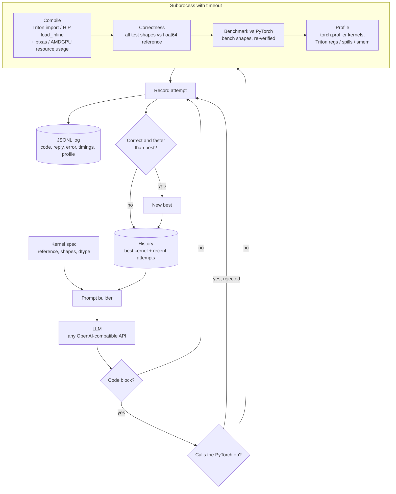

# kernelpilot

An LLM agent that writes, verifies and optimizes GPU kernels, plus the hand-written
kernels and the correctness/benchmark harness that keep it honest.

It has two parts:

1. **Hand-written kernels.** Six kernels written in HIP, each in stages from naive to
   best effort, with a Triton version of each. They are checked against
   float64 PyTorch references and benchmarked against PyTorch's built-ins.
2. **An agent.** It asks an LLM for a kernel, compiles it, runs it through the same
   correctness harness, benchmarks and profiles it, and feeds all of that back to the
   LLM. It keeps the fastest kernel that is correct.

> **Status: no measured results yet.** All code here was written and type-checked on
> a machine without a GPU. The tables below are filled by `make bench` and
> `make evaluate` on real hardware ([Colab T4 notebook](notebooks/colab_t4.ipynb)).
> No numbers in this repo are estimated or invented. See [Verification so far](#verification-so-far)
> for what has and hasn't been checked.

## Why

Writing fast kernels is mostly trial and error: form a hypothesis, write the kernel,
check that it is right, measure it, look at the profile, repeat. LLMs can now write
plausible kernels, but "plausible" isn't good enough. A kernel that's fast and wrong is
worse than useless, and LLM-written kernels fail in quiet ways: an off-by-one tile
edge, a missing max-subtraction that only overflows on large inputs, a TF32 matmul that
loses 3 digits. So the harness is the core of this project, and the agent is built
around it.

## Layout

```
csrc/compat.h            HIP <-> CUDA portability (one source, both vendors)
csrc/kernels/*.hip       hand-written kernels, all stages
csrc/bindings.cpp        PyTorch C++ extension (TORCH_LIBRARY -> torch.ops.kp.*)
CMakeLists.txt           builds build/libkernelpilot_ops.so for ROCm or CUDA
kernelpilot/specs.py     kernel specs: reference, shapes, dtypes, FLOPs/bytes, tolerances
kernelpilot/correctness.py   correctness harness
kernelpilot/benchmark.py     benchmark harness (events, warm-up, L2 flush, median)
kernelpilot/roofline.py      roofline plot
kernelpilot/triton_kernels/  Triton versions
kernelpilot/agent/       LLM client, prompts, sandboxed worker, optimize loop
kernelpilot/evaluation.py    PyTorch vs hand-written vs agent report
tools/syntax_check/      type-check kernels for NVIDIA + AMD with clang, no toolkit
tests/gpu                every kernel x shape x dtype vs reference (needs a GPU)
tests/cpu                harness + agent logic (runs anywhere; CI)
```

## Setup

Python 3.11+, PyTorch 2.4+, CMake 3.21+ (3.24+ for automatic CUDA arch detection).

### NVIDIA (e.g. Google Colab T4)

Open [notebooks/colab_t4.ipynb](notebooks/colab_t4.ipynb) in Colab with a T4 runtime,
or by hand:

```bash
git clone https://github.com/An1rudhSai/kernelpilot && cd kernelpilot
pip install -e ".[dev]" "cmake>=3.24"   # Colab already has CUDA PyTorch, nvcc and Triton
make build CUDA_ARCH=75                  # 75 = T4; omit to auto-detect ("native")
make test                                # correctness: every kernel, shape, dtype
make bench                               # results/bench.md + results/roofline.png
```

On NVIDIA the build copies each `.hip` file to `.cu` and compiles it with nvcc. The
few HIP-specific names the kernels use (`hipStream_t`, error checks, warp shuffles)
are mapped to CUDA in [csrc/compat.h](csrc/compat.h). The kernels never hard-code a
warp size: they read `warpSize` at runtime, which is 32 on NVIDIA and RDNA and 64 on
CDNA.

### AMD (ROCm)

```bash
pip install torch --index-url https://download.pytorch.org/whl/rocm6.2   # match your ROCm
pip install -e ".[dev]"                  # ROCm PyTorch wheels ship Triton for AMD
make build                               # uses /opt/rocm; arch from rocm_agent_enumerator
make test && make bench                  # override with HIP_ARCH=gfx90a / ROCM_PATH=...
```

The Makefile reads the backend from `torch.version.hip`. On ROCm, CMake compiles the
`.hip` files as the HIP language with ROCm's clang.

### Without a GPU

```bash
pip install -e ".[dev]" && make test-cpu             # harness + agent logic
CLANG=clang++ make typecheck                         # kernels as CUDA and as HIP
TRITON_INTERPRET=1 pytest tests/cpu/test_triton_interp.py   # Triton kernels on CPU (Linux)
```

## The harness

**Correctness** ([kernelpilot/correctness.py](kernelpilot/correctness.py)). Every
implementation runs on every test shape and dtype, and the output is compared with a
float64 PyTorch reference.

- Shapes include size 1, primes, non-powers of two, sizes just past a power of two
  (65537, 4097), and large sizes.
- The check is `|out - ref| <= atol + rtol*|ref|`, with tolerances set per dtype and,
  where it matters, scaled with the problem size: reduction error grows like
  `sqrt(n)` and matmul error like `K`.
- NaN or Inf in the output where the reference is finite counts as a failure.
- Also checked: output shape and dtype, and that the inputs were not changed in place.
- Softmax inputs are scaled by 30, so a kernel that skips the max-subtraction
  overflows and fails.
- A failure reports max abs and rel error, how many elements are out of tolerance, and
  the worst element's index with the value we got and the one we expected.

`make test` runs all of this through pytest.

**Benchmarks** ([kernelpilot/benchmark.py](kernelpilot/benchmark.py)):

- Each implementation is checked for correctness first. An incorrect one is reported
  as `FAILED correctness` and never timed.
- Warm-up runs come first.
- Each timed iteration has its own pair of GPU events, and L2 is flushed (a 256 MB
  write) before every iteration, outside the timed region.
- The reported time is the median of up to 100 iterations, capped by a time budget so
  naive kernels finish.
- Reported per row: time, GB/s, TFLOPS, % of peak bandwidth, % of peak FLOPS, and
  speedup over PyTorch.
- Bytes are the ideal compulsory traffic, e.g. one read and one write for softmax.
- Peaks come from a datasheet table ([device.py](kernelpilot/device.py)) or from the
  `KP_PEAK_*` env vars. For an unknown GPU, measured copy bandwidth is used.

TF32 stays off (PyTorch's default for matmul), so the fp32 baseline really is fp32. If
it weren't, the tolerance check would catch it.

## Hand-written kernels: what each stage does and why it should help

Stages are `hip:<name>` in the results, in order. "Why it helps" is the reason each
change should matter. The measured effect goes in the results tables.

### 1. Vector add (memory bound, 1 FLOP per 12 bytes in fp32)

| stage | change | why |
|---|---|---|
| `naive` | one thread per element | baseline |
| `gridstride` | bounded grid, 4 independent elements per iteration | less block-scheduling overhead; more loads in flight per thread (ILP) |
| `vectorized` | 128-bit loads/stores (`float4`, 8 halves), scalar tail | 4x fewer memory instructions, full-width transactions |

Triton: one blocked kernel. The ceiling is the GPU's memory bandwidth, so expect all
of them, PyTorch included, to land near the same GB/s.

### 2. Reduction (sum, fp32 accumulation)

| stage | change | why |
|---|---|---|
| `naive` | shared-memory tree with interleaved addressing (`tid % 2s`), one element per thread | the classic slow version: divergent warps, idle threads, one atomic per 256 elements |
| `seq_addressing` | contiguous active threads, grid-stride accumulation in registers, bounded grid | no divergence, no bank conflicts, ~1000 atomics in total instead of n/256 |
| `vec_warp_shuffle` | 128-bit loads, 2 accumulators per thread, warp-shuffle reduction + one shared-memory hop | shuffles keep the tree in registers with no `__syncthreads` per level; vector loads saturate bandwidth |

Triton: a persistent kernel with a block-wide register accumulator and one atomic per
program.

### 3. Softmax (row-wise, numerically stable)

| stage | change | why |
|---|---|---|
| `naive` | one thread per row, 3 loops | uncoalesced (neighbours are N elements apart); small M leaves the GPU idle |
| `block_per_row` | one block per row, block tree reductions for max and sum | coalesced, but still 3 reads + 1 write of the matrix |
| `online_fused` | online softmax (running max and rescaled sum in a single pass), merged with warp shuffles; the row is cached in shared memory when it fits (N ≤ ~12K) | max, sum and normalize fused: 1 read + 1 write, the ideal, for rows that fit; 2 reads + 1 write otherwise |

Triton: the whole row in registers when N ≤ 16384, otherwise a chunked online-softmax
kernel.

### 4. Matmul (FP32 and FP16, fp32 accumulation)

| stage | change | why |
|---|---|---|
| `naive` | one thread per output, K loop from global memory | ~0.25 FLOP per byte loaded; bound by L2/DRAM |
| `smem_tiled` | 32x32 tiles staged in shared memory (B padded against bank conflicts) | each global element is reused 32x from on-chip memory |
| `reg_tiled` | 64x64 block tile, 4x4 outputs per thread in registers, A stored transposed | 16 FMAs per 8 shared-memory reads: 4x less shared-memory traffic per FLOP |
| `vectorized` | 128x128 tile, 8x8 per thread, 128-bit global loads and 128-bit shared-memory reads (needs K, N % 4 == 0) | 64 FMAs per 4 vector reads; fewer load instructions; higher arithmetic intensity at every level |

Triton: a grouped-order (L2-friendly) tiled matmul, fixed config and autotuned.
**None of the HIP stages use tensor cores or matrix cores (WMMA/MFMA).** PyTorch's
fp16 matmul does, so on fp16 the hand-written kernels should lose by a wide margin.
That's expected and shown, not hidden. The roofline plots both the fp32 ceiling and
the fp16 matrix-core ceiling.

### 5. LayerNorm (fused, eps = 1e-5, biased variance)

| stage | change | why |
|---|---|---|
| `naive` | thread per row, 3 loops | as naive softmax |
| `block_two_pass` | block per row, mean then centred variance (numerically safe), then normalize | coalesced, but 3 reads of x |
| `welford_fused` | single-pass Welford mean/M2 per thread, merged across threads with Chan's parallel formula via warp shuffles; row cached in shared memory | 1 read + 1 write, without the cancellation of `E[x²] − E[x]²` |

Triton: the row in registers with centred variance, or a chunked 3-pass kernel for
very long rows.

### 6. Attention (stretch goal, non-causal, small S)

| stage | change | why |
|---|---|---|
| `naive` | block per (head, query): the full score row in shared memory, block softmax, then P·V | simple; re-reads K and V once per query |
| `flash_tiled` | thread per query, K/V tiles in shared memory shared by 64 queries, online softmax with a rescaled accumulator; D is a template parameter (16/32/64/128, others fall back to naive) | K/V traffic drops 64x; the S×S matrix never exists |

Triton: a flash-attention forward kernel with `tl.dot` on both products. One known
cost: `flash_tiled` keeps `q` and the accumulator in registers, so at D = 128 it will
spill. The Triton version doesn't have this problem.

## Results

> Filled in by running on a GPU (`./scripts/run_all.sh` does everything). Nothing has
> been measured yet. These sections are deliberately empty, not estimated.

- Benchmark tables: `results/bench.md` (one table per kernel: time, GB/s, TFLOPS,
  % of peak, speedup vs PyTorch, for every stage, dtype and benchmark shape)
- Roofline: `results/roofline.png`
- PyTorch vs hand-written best vs agent best, and agent failure modes:
  `results/evaluation.md`

## The agent



```bash
export KP_MODEL=<model>                  # any OpenAI-compatible endpoint
export KP_BASE_URL=https://api.openai.com/v1
export KP_API_KEY=...
kernelpilot optimize --kernel softmax --iterations 10            # Triton, fp32
kernelpilot optimize --kernel matmul --dtype float16 --lang hip --iterations 15
kernelpilot evaluate                                             # results/evaluation.md
```

How it works:

- **Input.** A `KernelSpec`: name, float64 PyTorch reference (its source goes into the
  prompt), test and benchmark shapes, and dtype.
- **Each iteration, the prompt contains:**
  - the contract: define `kernel_fn` with the given signature;
  - the target GPU and its peaks;
  - the best correct kernel so far, with its numbers;
  - the last three attempts, each with its compiler errors, the mismatch report
    (max abs/rel error, worst element), timings and % of peak, and profiler output.
- **The code of the last failed attempt** goes back in too, so the model can fix it
  rather than start over.
- **Isolation.** Each candidate is evaluated by `python -m kernelpilot.agent.worker`
  in a fresh process with a hard timeout. That catches hangs, segfaults and GPU
  faults (an illegal address poisons a CUDA context), and gives every candidate a
  clean context.
- **Correctness is a hard gate.** Only a candidate that passes every test shape, and
  then the benchmark shapes too, can become the best. A wrong kernel is never
  accepted, however fast it is. The CPU tests check this with a fake 100x-fast wrong
  kernel.
- **Guard against delegation.** A cheap textual check rejects candidates that just
  call the PyTorch op (`torch.softmax`, `a @ b`, `F.layer_norm`, ...). The profiler
  output in the log shows which GPU kernels actually ran, so a human can audit this.
- **Logging.** Every attempt is a JSONL line in `runs/`: code, raw reply, stage
  reached, error, correctness failures, per-shape timings, profile, compile log,
  latencies.
- **Saving.** The best kernel is saved to `agent_kernels/`.

**Failure modes are tracked, not hidden.** Every attempt ends in one of these stages:

| stage | meaning |
|---|---|
| `no_code` | the reply had no code block |
| `rejected` | the code delegated to PyTorch |
| `compile` | compile error |
| `correctness` | it compiled and ran but gave wrong numbers: a silent bug, caught |
| `timeout` | it didn't finish in time |
| `crash` | the process died |
| `ok` | correct, and benchmarked |

Correct attempts that are slower than the best so far are flagged as regressions.
`kernelpilot evaluate` tabulates all of these per run, along with iterations to the
first correct kernel and to the best one.

## Verification so far

What has been checked, and what hasn't:

| check | status |
|---|---|
| Harness logic: comparator, NaN, in-place, dtype, crash handling, tolerance specs | CPU tests pass |
| Agent loop, prompts, guard, JSONL, sandbox timeout, HTTP client, evaluation report | CPU tests pass (57 total) |
| Every `.hip` kernel parses and type-checks as CUDA (sm_75) and as HIP (gfx90a) | `make typecheck` passes |
| `bindings.cpp` compiles against PyTorch headers | passes (`-fsyntax-only`) |
| HIP kernels compiled by nvcc / hipcc and **run** on a GPU | **not yet** |
| Triton kernels run (GPU, or the CPU interpreter in CI) | **not yet** |
| Benchmarks, roofline, agent runs | **not yet** |

The first GPU run may turn up build or numerical problems the type-check can't catch.
`make test` will report them loudly.

## Lessons learned (from building it)

- **Verify on the benchmark shapes too.** Correctness on small test shapes doesn't
  prove a kernel is right at 4096² (int32 overflow in offsets, grid-size limits). The
  worker re-checks every benchmark shape before timing it.
- **Make instability fail loudly.** With N(0, 1) inputs, a softmax without
  max-subtraction often passes. Scaling the inputs by 30 makes `exp` overflow, so
  unstable kernels fail.
- **Watch for TF32.** Triton's `tl.dot` on fp32 defaults to TF32. That's about 1e-3
  relative error: fast-looking and wrong under an fp32 tolerance. The prompt and the
  hand-written Triton kernels force `input_precision="ieee"`.
- **Flush L2 between timed iterations.** For memory-bound kernels whose inputs fit in
  L2 (a T4 has 4 MB), back-to-back timing measures cache bandwidth, not DRAM.
- **Don't hard-code the warp size.** CDNA wavefronts are 64 wide. Shuffles and
  shared-memory scratch are written against runtime `warpSize`, sized for up to 32
  warps.
- **No fast-math.** `-ffast-math` implies finite-math-only, which lets the compiler
  delete the `-INFINITY` initial values that online softmax relies on.

## Limitations

- **No GPU results yet** (see above).
- **No matrix cores.** The hand-written matmul and attention don't use tensor cores or
  matrix cores, so fp16 comparisons with PyTorch (cuBLAS/rocBLAS, flash attention)
  favour PyTorch heavily.
- **The sandbox isolates, it doesn't secure.** It is a subprocess with a timeout, not
  a security boundary: generated code can reach the filesystem and network. Run the
  agent in a container or VM if that matters to you.
- **The delegation guard is textual.** It can be fooled, and it can reject legitimate
  code (e.g. Triton's `@` operator; the prompt asks for `tl.dot`). The logged profiler
  output is the real audit.
- **Peaks are datasheet numbers.** They can be overridden with `KP_PEAK_BW_GBS`,
  `KP_PEAK_FP32_TFLOPS` and `KP_PEAK_FP16_TFLOPS`. "Bytes moved" is ideal compulsory
  traffic, not measured DRAM traffic.
- **Narrow kernels.** Inputs must be contiguous. Attention is non-causal with no
  masking, and `flash_tiled` supports D ∈ {16, 32, 64, 128}.
- **Results can vary run to run.** The agent's results depend on the model,
  temperature and iteration budget, and a single run is one sample. Compare several
  runs before drawing conclusions.

## CI

[.github/workflows/ci.yml](.github/workflows/ci.yml) runs these jobs:

- ruff lint;
- the CPU tests;
- the Triton kernels under `TRITON_INTERPRET=1`;
- an nvcc compile of every kernel;
- the clang type-check for both vendors.

GPU tests run locally with `make test`.
